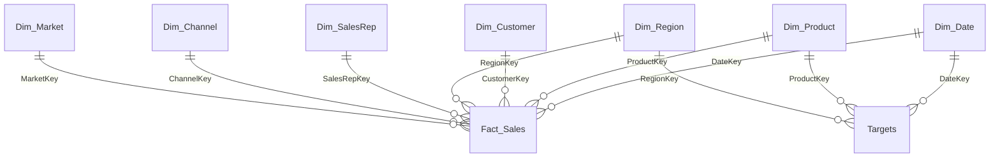

# NovaPharma Global: Business Intelligence Case Study (Case 001)

**An end-to-end Power BI project that answers five executive questions about sales, margin, customers, marketing and supply chain for a fictional pharmaceutical company.**

Built as Team Lead of **Silver Pod 4** for the Databeauty Tribe x La Grande Galaxie Monthly Business Challenge, where the team placed 2nd among the pods.

| | |
|---|---|
| **Role** | Team Lead, Silver Pod 4 |
| **Tools** | Excel, Power Query, Power BI Desktop, DAX |
| **Deliverables** | 5-page Power BI dashboard, executive summary, insights and impact, business recommendations, supporting report, presentation |
| **Status** | Version 1 complete. A data-scope issue is documented below and a full-data re-run is planned. |

> **Read this first: data scope.** The dashboard in this repository was built on **39 of the 5,015 `Fact_Sales` records**. A Power Query filter step kept only the rows with a missing Discount. This is explained in [Known issues](#known-issues-and-limitations). All figures below are from that 39-record sample and should be read as directional, not as company-wide results.

---

## Table of contents

1. [Business context](#business-context)
2. [Business questions](#business-questions)
3. [Data and model](#data-and-model)
4. [Data preparation](#data-preparation)
5. [DAX measures](#dax-measures)
6. [Dashboard pages](#dashboard-pages)
7. [Key findings](#key-findings)
8. [Recommendations](#recommendations)
9. [Known issues and limitations](#known-issues-and-limitations)
10. [Next steps](#next-steps)
11. [Repository structure](#repository-structure)
12. [How to open the project](#how-to-open-the-project)
13. [About the author](#about-the-author)

---

## Business context

NovaPharma Global is a pharmaceutical company operating across 25 countries. Revenue has grown, but leadership has raised four concerns:

- Falling profitability
- Regional underperformance
- Inventory shortages
- Possible revenue leakage

The task was to build a dashboard and a set of written deliverables that tell each executive where the problem is and what to do about it.

## Business questions

| Stakeholder | Question | Dashboard page |
|---|---|---|
| **CEO** | Which products and markets drive growth? | Executive Overview |
| **CFO** | Where is revenue leaking, and where is margin weak? | CFO (Margin and Leakage) |
| **CCO** | Which reps and channels create the most value? | CCO (Customer and Channel) |
| **CMO** | Which campaigns deliver the best return? | CMO (Campaign ROI) |
| **CSCO** | Which products run out of stock, and what does it cost? | CSCO (Stock-Outs) |

## Data and model

The source is an Excel workbook (`DBT_BCS_CS001.xlsx`) with one fact table and several dimension tables, modelled as a **star schema** in Power BI.

| Table | Type | Rows in model | Description |
|---|---|---|---|
| `Fact_Sales` | Fact | 39 (source: 5,015) | Sales transactions: units, price, revenue, cost, profit, forecast, rebate, stock levels, stock-out days, lead time |
| `Targets` | Fact | 21,000 | Revenue, profit and unit targets by date, product and region |
| `Dim_Date` | Dimension | 731 | Calendar for 2024 and 2025 |
| `Dim_Product` | Dimension | 35 | Product, drug class, category, patent status |
| `Dim_Customer` | Dimension | 700 | Customer name, type, segment, country |
| `Dim_Region` | Dimension | 25 | Region, country, territory, warehouse (6 regions) |
| `Dim_SalesRep` | Dimension | 40 | Rep, team, manager, years of experience |
| `Dim_Channel` | Dimension | 5 | Sales channel |
| `Dim_Market` | Dimension | 20 | Marketing campaigns: type, channel, spend, ROI |



## Data preparation

Done in Power Query:

- Handled missing values in `Fact_Sales` (Discount, Rebate, LeadTimeDays)
- Checked for duplicate records and inconsistent text across the dimension tables
- Corrected data types where the source data dictionary did not match the actual data
- Built the relationships shown above

## DAX measures

22 measures were created.

| Group | Measure | Definition |
|---|---|---|
| **Core** | Total Revenue | `SUM(Fact_Sales[Revenue])` |
| | Total Profit | `SUM(Fact_Sales[Profit])` |
| | Total Cost | `SUM(Fact_Sales[Cost])` |
| | Profit Margin % | `DIVIDE([Total Profit], [Total Revenue], 0)` |
| | Total Units Sold | `SUM(Fact_Sales[UnitsSold])` |
| | Avg Deal Size | `DIVIDE([Total Revenue], COUNTROWS(Fact_Sales), 0)` |
| **Leakage** | Total Discount | `SUM(Fact_Sales[Discount])` |
| | Total Rebate | `SUM(Fact_Sales[Rebate])` |
| | Gross Revenue (before discount) | `SUM(Fact_Sales[Revenue]) + SUM(Fact_Sales[Discount])` |
| | Discount Rate % | `DIVIDE([Total Discount], [Total Revenue], 0)` |
| | Rebate Rate % | `DIVIDE([Total Rebate], [Total Revenue], 0)` |
| | Revenue Leakage % | `DIVIDE([Total Discount] + [Total Rebate], [Total Revenue], 0)` |
| **Supply chain** | Total StockOut Days | `SUM(Fact_Sales[StockOutDays])` |
| | Avg Lead Time (Days) | `AVERAGE(Fact_Sales[LeadTimeDays])` |
| | StockOut Transactions | `CALCULATE(COUNTROWS(Fact_Sales), Fact_Sales[StockOutDays] > 0)` |
| | Est. Revenue Lost to StockOuts | `CALCULATE(SUM(Fact_Sales[Revenue]), Fact_Sales[StockOutDays] > 0)` |
| **Customers** | Revenue per Customer | `DIVIDE([Total Revenue], DISTINCTCOUNT(Fact_Sales[CustomerKey]), 0)` |
| | Active Customers | `DISTINCTCOUNT(Fact_Sales[CustomerKey])` |
| **Marketing** | Total Marketing Spend | `SUM(Dim_Market[MarketingSpend])` |
| | Marketing ROI | `DIVIDE([Total Revenue] - [Total Marketing Spend], [Total Marketing Spend], 0)` |
| **Targets** | Target Revenue | `SUM(Targets[RevenueTarget])` |
| | Target Achievement % | `DIVIDE([Total Revenue], [Target Revenue], 0)` |

## Dashboard pages

| # | Page | What it shows |
|---|---|---|
| 1 | **Executive Overview** | Headline KPIs, actual vs target trend, revenue by product and region |
| 2 | **CSCO (Stock-Outs)** | Stock-out days by product and region, lead time, revenue touched by stock-outs |
| 3 | **CFO (Margin and Leakage)** | Margin by region and product, leakage, revenue vs profit trend |
| 4 | **CCO (Customer and Channel)** | Top reps, customer segments, channels, revenue per customer |
| 5 | **CMO (Campaign ROI)** | Spend and revenue by campaign |

<!-- Add your screenshots to /images and uncomment these lines


-->

## Key findings

All figures come from the **39-record sample** loaded in the dashboard (see the data scope note at the top).

**Headline numbers:** revenue 4,067,116, profit 1,511,423, profit margin 37.16%. Actual revenue came within about 3.4% of the company's own forecast (96.6% accuracy).

### 1. Europe earns a lot of revenue but the least profit per sale
Europe is the 2nd-largest region by revenue (919,872, behind Africa at 1,188,064) but has the lowest margin of all six regions at **31.2%**. The Middle East is highest at 49.5%. Europe also has the second-highest stock-out count (28 days).

### 2. The biggest sales channel is the least profitable
Retail Pharmacy brings in the most channel revenue (1,233,606) but has the weakest channel margin at **31.7%**. Government Tender has the best margin at 43.1%.

### 3. Top seller is not the same as best performer
Rep 25 leads on revenue (482,273) with a healthy 39.7% margin. Rep 4 is a close second on revenue (393,954) but earns only **28.2%**. A revenue-only leaderboard hides this.

### 4. Stock-outs are widespread
**33 of 39 transactions (about 85%)** were affected by stock-out activity, touching 3,658,706 in revenue. Product 31 has the most stock-out days (18) and Asia-Pacific the most by region (34 days). The pattern points to a systemic supply problem, not isolated products.

### 5. Directional signal: margin slipping through 2024
Quarterly margin in the sample moved from **43.6% in Q1 2024 to 37.0% in Q4 2024**, while quarterly revenue rose. This matches the brief's concern that growth is not turning into profit. Treat it as directional only, because some quarters contain just 3 to 4 transactions.

## Recommendations

| Stakeholder | Recommendation |
|---|---|
| **CEO** | Prioritise fixing Europe's margin before chasing more volume there |
| **CFO** | Report revenue and profit side by side by region and channel so margin gaps are visible early |
| **CCO** | Use Rep 25 as a coaching model for Rep 4, and add a minimum margin threshold to rep performance reviews. Review Retail Pharmacy pricing and discount practice |
| **CSCO** | Treat stock-outs as a systemic reliability issue. Start with Product 31 and Asia-Pacific |
| **CMO** | Set a minimum ROI threshold below which a campaign is paused or redesigned. Campaign-level recommendations are on hold until the full-data re-run |

## Known issues and limitations

This section documents what was found when reviewing the model, so the findings above are read in context.

1. **Only 39 of 5,015 `Fact_Sales` rows are loaded.** In Power Query, the `Fact_Sales` query contains a filter step (`Filtered Rows`, `[Discount] = null`) that keeps only the rows with a missing Discount. Every other row is dropped. This is the cause of the small sample. The three `Filtered Rows` steps should be deleted.
2. **Discount is a placeholder.** All 39 loaded rows have a Discount of 0.5, set by the query's replace step. The source column holds a rate, while Revenue and Rebate are amounts, so the `Revenue Leakage %` measure (0.24%) mixes units and is **not a reliable finding**. It is not used above.
3. **Campaign ROI from the sample conflicts with the source.** The `Marketing ROI` measure divides sample revenue by campaign spend, which produced extreme results (such as 20.5x and negative returns). The `Dim_Market` table has its own ROI column that tells a different story. Campaign conclusions are excluded until the full dataset is loaded.
4. **Target achievement is not comparable.** The `Targets` table has 21,000 rows (about 3.67 billion in total target revenue) while the loaded sales are only 39 rows. The resulting 0.11% achievement rate reflects the mismatch, not performance.
5. **Small groups.** Some regions have very few transactions (North America has 1), so regional rankings can change once the full data is loaded.
6. **Customer relationship.** `Fact_Sales` to `Dim_Customer` shows as one-to-one because each of the 39 rows has a different customer. With the full data it should be many-to-one.

## Next steps

- [ ] Remove the `Filtered Rows` steps from the `Fact_Sales` query and reload all 5,015 rows
- [ ] Replace the Discount placeholder with a proper treatment, and fix the leakage measure so rates and amounts are not mixed
- [ ] Re-run every dashboard page and refresh the findings and recommendations
- [ ] Revisit campaign ROI using the source ROI column alongside the calculated measure
- [ ] Rebuild the target comparison at matching date, product and region level
- [ ] Add dashboard screenshots to `/images`

## Repository structure

```
novapharma-bi-case-study/
├── README.md
├── dashboard/
│   └── NOVAPHAM.pbix
├── docs/
│   ├── NovaPharma_Final_Business_Challenge.pdf
│   └── NovaPharma_Case001_Presentation.pptx
└── images/
    └── (dashboard screenshots)
```

## How to open the project

1. Download `NOVAPHAM.pbix` from the `dashboard` folder.
2. Open it in **Power BI Desktop** (free for Windows).
3. The file reads from a local Excel workbook. If Power BI asks for the source, point it to your copy of `DBT_BCS_CS001.xlsx` under **Home > Transform data > Data source settings**.

## About the author

**Chisom Precious** is an e-commerce data analyst and CRM operations specialist who turns scattered sales, customer and operations data into clear decisions.

- LinkedIn: [linkedin.com/in/chisomprecious-8685b4282](https://www.linkedin.com/in/chisomprecious-8685b4282)
- Portfolio: [chisomdata.github.io](https://chisomdata.github.io/)
